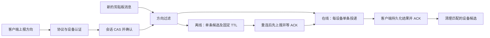

# RustClipSync Server

当前接口统一为 `/api/...`。服务端、各客户端及按路径过滤的反向代理需要配套更新；设备令牌、游标和加密数据保持不变。

[English](README.md) · 简体中文

RustClipSync 是面向个人设备的轻量 Rust 文本剪贴板同步服务，目标是较低的内存占用。它采用自有 RustClipSync 协议：离线期间只追上最新内容，通过消息 UUID、服务端版本和设备游标处理重试与重复通知。

## 客户端与协议

- Android：[Fcitx5 Android 输入法 fork](https://github.com/Infinifar/fcitx5-android-bibi-keyboard)，内置 RustClipSync 同步模块，保留说点啥语音输入支持。
- Omarchy：[Omaclipsync 插件](https://github.com/Infinifar/omaclipsync)。
- Windows 与 Linux：[RustClipSync Desktop](https://github.com/Infinifar/rustclipsync-desktop)，Windows 11 使用 WinUI 3，Linux 使用独立的 Qt 6/QML 界面，支持后台同步、加密历史和敏感收件区。Linux 提供面向 Debian 12、Ubuntu 24.04、Fedora 43 和 Arch/Omarchy 的 x86_64 安装包，无需 Omarchy 或 Quickshell。可从 [Release 页面](https://github.com/Infinifar/rustclipsync-desktop/releases)下载；Windows 安装包目前未签名。安装及桌面要求见 [Linux 使用说明](https://github.com/Infinifar/rustclipsync-desktop/blob/main/LINUX.md)：支持 X11，Wayland 需要 data-control 支持，缺少该协议的 GNOME/Wayland 会话暂不支持。
- 共享客户端核心：[rustclipsync-core](https://github.com/Infinifar/rustclipsync-core)，提供 Rust 客户端的同步状态机和 HTTPS 协议实现；Windows/Linux 桌面客户端与 Omaclipsync 插件分别提供平台适配。
- 其他客户端：[接口协议与适配说明](PROTOCOL.md)。初次登记从当前版本开始，不回放旧剪贴板；断线期间只追上最新状态，本地待发送内容与远端冲突时需用户确认。剪贴板写入与本地游标不能原子提交，异常崩溃时不保证严格恰好一次。

只同步 UTF-8 文本，单条上限 10 MiB，不支持图片、文件或多账户。敏感文本默认不传输；只有来源应用明确标记的敏感内容才能被识别。

## 与 SyncClipboard 的关系

本项目早期实现过 [SyncClipboard](https://github.com/Jeric-X/SyncClipboard) 文本协议兼容；当前版本是独立的 Rust 协议实现，**不兼容 SyncClipboard 客户端或服务端**，也不是其服务端源码的 Rust 移植。

| 方面 | RustClipSync | SyncClipboard |
| --- | --- | --- |
| 范围 | 轻量文本同步；需要专门适配的客户端 | 跨平台客户端、文本、图片、历史及其他存储后端，功能更广 |
| 离线与重复 | 每次复制使用 UUID；服务端版本和每设备游标处理重试、回声和最新值；离线不补发中间历史 | 有自己的同步与历史机制；具体去重行为取决于版本与客户端 |
| 隐私 | HTTPS 传输、SQLCipher 数据库加密、设备独立令牌可撤销；敏感标记默认不传输 | 支持自行部署及多种后端；安全和数据保护取决于部署及客户端配置 |
| 取舍 | 功能和兼容客户端较少；服务端可读取正文，尚无端到端加密 | 平台和功能覆盖更广；资源使用及安全能力应以实际版本和部署为准 |

没有对两者进行同条件性能或安全审计，不据此宣称绝对优势。一次本机回环测试中，服务端空闲 RSS 约 9.4 MiB；5 分钟合成负载中 RSS 约从 9.45 增至 11.74 MiB、无请求错误。这些数值不代表公网、所有负载或长期运行结果。

## Docker Compose 部署

需要 Docker Compose、可用的 HTTPS 反向代理或 Cloudflare Tunnel。下面的 `docker-compose.yml` 使用 `latest` 镜像；升级时先备份数据，再执行 `docker compose pull` 和 `docker compose up -d`。如需固定版本，可将标签改为 `v2.0.0`。容器仅在宿主机 `127.0.0.1:8090` 开放端口：

```yaml
services:
  rustclipsync:
    image: ghcr.io/infinifar/rustclipsync-server:latest
    restart: unless-stopped
    ports:
      - "127.0.0.1:8090:8090"
    environment:
      RCS_USER: ${RCS_USER:?set RCS_USER}
      RCS_PASSWORD_FILE: /run/secrets/rcs_password
      RCS_DB_KEY: ${RCS_DB_KEY:?set RCS_DB_KEY to 64 hexadecimal characters}
      RCS_HISTORY_RETENTION_DAYS: ${RCS_HISTORY_RETENTION_DAYS:-7}
    secrets:
      - rcs_password
    volumes:
      - clipsync_data:/data
    security_opt:
      - no-new-privileges:true
    cap_drop:
      - ALL
secrets:
  rcs_password:
    file: ./password.secret
volumes:
  clipsync_data:
    name: rustclipsync_data
```

在文件所在目录创建配置，替换账户名并交互输入至少 12 字节的随机密码：

```sh
umask 077
printf 'RCS_USER=%s\n' 'your-user' > .env
printf 'RCS_DB_KEY=%s\n' "$(openssl rand -hex 32)" >> .env
read -rs -p 'Password: ' rcs_password; printf '\n'
printf '%s' "$rcs_password" > password.secret
unset rcs_password
sudo chgrp 10001 password.secret
chmod 0440 password.secret
docker compose up -d
docker compose ps
curl http://127.0.0.1:8090/healthz
```

`.env` 中的 `RCS_DB_KEY` 是 32 字节密钥的 64 位十六进制表示，必须妥善备份；丢失后无法恢复数据库。Docker 管理员可读取容器环境变量。单独更改密钥不会重新加密数据库。账号密码用于登记和管理设备，同步使用独立设备令牌。不要将 `.env`、密码文件或备份提交到仓库。

将 HTTPS 代理指向 `http://127.0.0.1:8090`，转发 `/`、`/favicon.svg`、`/favicon.ico`、`/healthz` 和 `/api/`；长轮询最长 25 秒，代理超时应更长。客户端填写 HTTPS 根地址、账户和密码进行配对。HTTPS 保护传输，但服务端运行时可读取正文；当前不提供端到端加密。

历史默认保留 7 天；可在 `.env` 中设置 `RCS_HISTORY_RETENTION_DAYS` 为 1–3650 天，并重新创建容器。当前文本始终保留，消息 ID 和取消回执至少保留 30 天；清理不等于安全擦除。

## 设备管理

可选的[设备管理页面](ADMINISTRATION.md)位于 `/admin/`，支持手机和桌面访问，分为**设备、账户、设置**三个页签。设备页显示同步方向、暂停、方向上报状态（已接受／未知／已撤销／已过期）和近期活动；展开详情可查看上报时间、方式、版本、活动有效期、数据租约及最后确认修订号。支持设备备注、创建多设备共用的同步账户，以及撤销单台设备或整个账户。所有账户共享同一份剪贴板。“在线”表示近 60 秒内有认证活动；方向已接受、租约有效都不代表客户端已写入系统剪贴板。管理页读取不会延长设备活动或方向 TTL。页头提供 GitHub 项目入口，登录前后均可访问。

唯一管理员通过本地 `.env` 中独立的 `RCS_ADMIN_USER` 和 `RCS_ADMIN_PASSWORD` 配置，也可以使用该账户配对同步客户端，无需单独的管理员密码文件。现有 `RCS_USER` 凭据和已登记的设备令牌继续用于同步；配置独立管理员后，旧同步账户不再具有设备管理权限。设备账户只能同步，不能管理服务端。网页默认关闭；启用方法见[配置与安全说明](ADMINISTRATION.md)：使用 `docker-compose.admin.yml` 并配置 HTTPS Origin。浏览器使用短时 HttpOnly 会话、CSRF 防护和有界认证限速，设备账户密码以 Argon2id 散列保存。数据库自动增加字段，保留设备身份凭据，但使用它们的客户端必须适配协议 3。

## 按方向分发与重连补发

本版本要求**客户端协议 3**。旧客户端会收到 HTTP 426（`PROTOCOL_UNSUPPORTED`），请搭配旧版服务端使用；接口前缀仍为 `/api/`。core、服务端和客户端应成套升级，开发分支不会自动替换生产服务。

| 客户端状态 | 上传 | 接收 |
| --- | --- | --- |
| 仅推送 | 允许 | 不允许 |
| 仅接收 | 不允许 | 允许 |
| 双向同步 | 允许 | 允许 |
| 暂停 | 不允许 | 不允许 |
| 未知／已撤销／已过期 | 不允许 | 不允许 |

客户端在连接、重连及开关变更后报告最新方向，等待 ACK 才接收。`/api/ws` 的 WebSocket 控制通道和 HTTP 降级共用会话与版本 CAS，迟到请求不能复活旧会话。退出登录撤销方向，普通退出进程保留离线补发资格；30 天无有效活动则方向过期。暂停保留配对和已选方向，但清理待投递记录。本地方向、敏感内容与正则过滤继续兜底。



管理页的**设置**页签包含**重连补发时间窗口**，配置键为 `sync.reconnect.backfill.window`：全局默认 **5 分钟**，范围 **0–1440**，保存后立即生效，无需重启。**0 关闭离线存储和补发，不关闭在线实时同步**。每设备只保存最近一条满足条件的候选，引用同一份加密正文，不按设备复制文本。非零窗口变更只影响新候选的写入 TTL；设为 0 会清理旧离线候选。仅管理员可修改，数据库审计保存修改人、时间和前后值。非法输入拒绝保存；运行时配置缺失、损坏或越界时固定以 **0** 兜底并告警。

[接口规范](PROTOCOL.md)和[方向协议](docs/DIRECTION-PROTOCOL.md)说明 WS 消息、HTTP DTO、会话防重放、ACK、过期和错误码。同步请求必须携带 `X-RCS-Protocol: 3`，数据请求另带 `X-RCS-Sync-Session`。全局 `revision` 用于发送冲突检测，可为空的 `deliveryRevision` 才是本设备接收消息版本；元数据和正文下载均受过滤。HTTP 在线租约为 30 秒，管理页的近期活动状态不代表连接一定可达。

仅管理员可访问的 `GET /api/admin/sync-settings` 提供当前窗口、最近配置审计、上报成功／失败、WS／HTTP 来源、过滤／未知／撤销／过期／补发计数和配置告警。计数在重启后归零，设置与审计保存在 SQLCipher。补发计数表示选中的候选，成功处理另由客户端 ACK 确认。JSON 日志只记录经过校验的设备／消息 ID 和原因，不记录正文或凭据。设置 `RUST_LOG=debug` 可排查过滤原因；无消息时依次检查协议版本、方向 ACK 与当前会话、暂停／接收策略、补发窗口和 TTL，最后检查本地过滤。数据库、Origin 和管理员凭据配置见[管理说明](ADMINISTRATION.md)。

## 升级、备份与恢复

从旧协议升级前，停止服务并备份完整数据卷、密钥、密码和旧镜像；旧协议数据不会自动作为新协议消息发送。旧版客户端需要更换为 RustClipSync 客户端。

明文数据库迁移前先停止服务并备份，然后运行 `docker compose run --rm --no-deps rustclipsync --migrate-db`。迁移保留明文备份，需单独保护或在确认后处理。

恢复本协议的数据库备份后，在服务停止且无其他进程使用数据库时运行 `docker compose run --rm --no-deps rustclipsync --rotate-epoch`。这会撤销设备令牌并更换实例标识，所有设备须重新配对。回退旧服务时应恢复与旧镜像匹配的数据库备份和客户端。

## 开发验证

```sh
cargo fmt --check
cargo clippy --locked --all-targets -- -D warnings
cargo test --locked
cargo build --release --locked
python3 benchmarks/api_benchmark.py target/release/rustclipsync-server
```

基准使用临时加密数据库与合成文本，不代表公网性能。服务端采用 MIT 许可；客户端保留各自许可。
