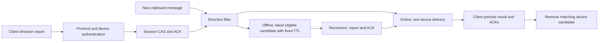

# RustClipSync Server

This release uses only `/api/...`. Update the clients and any path-filtering reverse proxy together with the server; device tokens, cursors and encrypted data remain unchanged.

English · [简体中文](README-ZH.md)

RustClipSync is a lightweight Rust text clipboard server for personal devices, designed for low memory use. Its dedicated protocol uses message UUIDs, server revisions and device cursors to handle retries and duplicate notifications; devices catch up only to the latest content after being offline.

## Clients and protocol

- Android: [Fcitx5 Android input method fork](https://github.com/Infinifar/fcitx5-android-bibi-keyboard), with built-in RustClipSync synchronization and BiBi voice input support.
- Omarchy: [Omaclipsync plugin](https://github.com/Infinifar/omaclipsync).
- Windows and Linux: [RustClipSync Desktop](https://github.com/Infinifar/rustclipsync-desktop), with a WinUI 3 interface on Windows 11 and a standalone Qt 6/QML interface on Linux, plus background synchronization, encrypted history and a sensitive inbox. Linux x86_64 packages target Debian 12, Ubuntu 24.04, Fedora 43 and Arch/Omarchy; the Linux app does not require Omarchy or Quickshell. Download from [Releases](https://github.com/Infinifar/rustclipsync-desktop/releases); Windows installers are currently unsigned. See the [Linux guide](https://github.com/Infinifar/rustclipsync-desktop/blob/main/LINUX.md) for installation and desktop requirements: X11 is supported; Wayland requires data-control support, and GNOME/Wayland sessions without it are currently unsupported.
- Shared client library: [rustclipsync-core](https://github.com/Infinifar/rustclipsync-core) implements the Rust synchronization state machine and HTTPS protocol; RustClipSync Desktop on Windows/Linux and the Omaclipsync plugin provide their own platform adapters.
- Other clients: see the [protocol and integration guide](PROTOCOL.md). Registration starts at the current revision without replaying old clipboard content. Offline devices catch up to the latest state, and conflicts with pending local content require user confirmation. Clipboard writes and local cursors cannot be committed atomically, so an unexpected crash cannot guarantee exactly-once effects.

Only UTF-8 text is synchronized, up to 10 MiB per item. Images, files and multiple accounts are not supported. Marked sensitive text is not synchronized by default; only content marked by its source application can be recognized.

## Relationship to SyncClipboard

An earlier implementation supported the [SyncClipboard](https://github.com/Jeric-X/SyncClipboard) text protocol. The current server implements an independent RustClipSync protocol: it is **not compatible with SyncClipboard clients or servers** and is not a Rust port of its server source.

| Aspect | RustClipSync | SyncClipboard |
| --- | --- | --- |
| Scope | Lightweight text synchronization; requires adapted clients | Broader platform coverage, text, images, history and other storage backends |
| Offline and duplicates | UUID per copy; server revisions and device cursors handle retries, echoes and latest state; intermediate offline history is not replayed | Has its own synchronization and history mechanisms; deduplication depends on version and client |
| Privacy | HTTPS transport, SQLCipher database encryption and revocable device tokens; marked sensitive text is excluded by default | Supports self-hosting and multiple backends; security and data protection depend on deployment and client configuration |
| Trade-offs | Fewer features and compatible clients; server can read text and end-to-end encryption is not available | Wider feature and platform coverage; resource use and security depend on the version and deployment |

These projects have not undergone a controlled comparative performance or security audit. In one local loopback test, idle server RSS was approximately 9.4 MiB; during a five-minute synthetic workload it rose from about 9.45 to 11.74 MiB with no request errors. These numbers do not represent public networks, every workload or long-running behavior.

## Docker Compose deployment

Docker Compose and an HTTPS reverse proxy or Cloudflare Tunnel are required. This `docker-compose.yml` uses `latest`. Back up data before upgrading, then run `docker compose pull` and `docker compose up -d`. To pin a release, change the tag to `v2.0.0`. The container port is published only on host loopback `127.0.0.1:8090`:

```yaml
services:
  rustclipsync:
    image: ghcr.io/infinifar/rustclipsync-server:latest
    restart: unless-stopped
    ports:
      - "127.0.0.1:8090:8090"
    environment:
      RCS_USER: ${RCS_USER:?set RCS_USER}
      RCS_PASSWORD_FILE: /run/secrets/rcs_password
      RCS_DB_KEY: ${RCS_DB_KEY:?set RCS_DB_KEY to 64 hexadecimal characters}
      RCS_HISTORY_RETENTION_DAYS: ${RCS_HISTORY_RETENTION_DAYS:-7}
    secrets:
      - rcs_password
    volumes:
      - clipsync_data:/data
    security_opt:
      - no-new-privileges:true
    cap_drop:
      - ALL
secrets:
  rcs_password:
    file: ./password.secret
volumes:
  clipsync_data:
    name: rustclipsync_data
```

In the same directory, create configuration, replace the username and enter a random password of at least 12 bytes when prompted:

```sh
umask 077
printf 'RCS_USER=%s\n' 'your-user' > .env
printf 'RCS_DB_KEY=%s\n' "$(openssl rand -hex 32)" >> .env
read -rs -p 'Password: ' rcs_password; printf '\n'
printf '%s' "$rcs_password" > password.secret
unset rcs_password
sudo chgrp 10001 password.secret
chmod 0440 password.secret
docker compose up -d
docker compose ps
curl http://127.0.0.1:8090/healthz
```

`RCS_DB_KEY` in `.env` is a 64-character hexadecimal representation of a 32-byte key. Back it up securely: the database cannot be recovered without it. Docker administrators can read container environment variables. Changing the key alone does not re-encrypt the database. The account password registers and manages devices; synchronization uses individual device tokens. Do not commit `.env`, the password file or backups.

Point the HTTPS proxy to `http://127.0.0.1:8090` and forward `/`, `/favicon.svg`, `/favicon.ico`, `/healthz` and `/api/`. Long polls can last 25 seconds, so configure a longer proxy timeout. Pair clients using the HTTPS root URL, username and password. HTTPS protects transport, but the server can read text while running; end-to-end encryption is not currently provided.

History is retained for seven days by default. Set `RCS_HISTORY_RETENTION_DAYS` in `.env` to 1–3650 and recreate the container to change it. Current text is always retained; message IDs and cancellation receipts are kept for at least 30 days. Cleanup is not secure erasure.

## Device administration

An optional, responsive [administration page](ADMINISTRATION.md) at `/admin/` has **Devices**, **Accounts**, **Settings** and **About** tabs. View each device's send/receive direction, pause state, accepted/unknown/revoked/expired report and recent activity. Expand sync details for report time/source/version, activity expiry, data lease and acknowledged revision. Label devices, create sync-only accounts shared by several devices, or revoke one device or an entire account. All accounts share one clipboard. Online means authenticated activity within 60 seconds; an accepted direction or active lease does not prove a client wrote its system clipboard. Metadata reads do not refresh device activity or direction TTL. The About tab contains server version, routing diagnostics and receive troubleshooting. Its manual update check queries public GitHub releases without sending credentials; it never updates the container automatically. The header links to this GitHub project, including before sign-in.

The unique administrator has separate `RCS_ADMIN_USER` and `RCS_ADMIN_PASSWORD` credentials read from the local `.env`; the administrator can also pair sync clients. Existing `RCS_USER` credentials and issued device tokens remain valid for synchronization. With an independent administrator configured, the old sync account no longer grants device-management access. Device accounts cannot administer the server. The web page is disabled by default; follow the [setup and security guide](ADMINISTRATION.md) to use `docker-compose.admin.yml` and configure an HTTPS origin. No separate administrator password file is needed. It uses short-lived HttpOnly sessions, CSRF protection, bounded password authentication and Argon2id account password hashes. Schema additions preserve existing device credentials; using them requires a protocol-3 client.

## Direction filtering and reconnect backfill

This release requires **client protocol 3**. Older clients are rejected with HTTP 426 (`PROTOCOL_UNSUPPORTED`); use the previous server release with old clients. `/api/` remains the route prefix. Upgrade the core and clients together; the development branch is not an automatic production rollout.

| Client state | Upload | Receive |
| --- | --- | --- |
| Push only | Yes | No |
| Receive only | No | Yes |
| Bidirectional | Yes | Yes |
| Paused | No | No |
| Unknown / revoked / expired | No | No |

Clients report direction after connection/reconnection and on setting changes. They wait for an ACK before receiving. WebSocket direction control at `/api/ws` and HTTP fallback share the same session/version CAS, preventing delayed requests from restoring an old session. Explicit logout revokes direction; normal process exit preserves offline eligibility. Valid direction expires after 30 inactive days. Pausing keeps the selected direction and pairing, and clears pending deliveries. Local direction/sensitive/regex filters remain additional safeguards.



The management page’s **Settings** tab contains **Reconnect backfill**, backed by `sync.reconnect.backfill.window`. It is global, defaults to **5 minutes**, accepts **0–1440**, and saves immediately without restart. **0 disables offline storage and replay**, while online synchronization still works. Each device keeps only its newest eligible candidate, referencing the shared encrypted message rather than copying its text. Nonzero setting changes affect newly written TTLs only; zero clears old offline candidates. Only the administrator may save it; actor, time, old value and new value are audited. Invalid input is rejected. Missing, corrupt or out-of-range runtime configuration falls back to **0** with a warning.

The [wire specification](PROTOCOL.md) and [direction contract](docs/DIRECTION-PROTOCOL.md) cover WS frames, HTTP DTOs, session fencing, ACKs, expiry and errors. All sync requests require `X-RCS-Protocol: 3`; data requests also use `X-RCS-Sync-Session`. Global `revision` is the sending conflict baseline; nullable `deliveryRevision` identifies the per-device receive event. Metadata and body downloads are both filtered. HTTP uses a 30-second online lease; the management page's recent-activity badge is an observation, not proof of connectivity.

Administrator-only `GET /api/admin/sync-settings` reports the effective window, recent audit entries, report/error/WS/HTTP/filter/unknown/revocation/expiry/backfill counters and configuration alerts. Counters reset on restart; the settings and audit survive in SQLCipher. Backfill counts record selected candidates; delivery is confirmed separately by client ACK. JSON logs contain validated device/message IDs and reasons, never clipboard text or credentials. Set `RUST_LOG=debug` for filtered-message diagnostics. If no message arrives, check protocol 3, a successful direction ACK/current session, pause/receive policy, the offline window/expiry, then local filters. Database, Origin and credential setup remain in the [administration guide](ADMINISTRATION.md).

## Upgrades, backup and recovery

Before upgrading from the old protocol, stop the service and back up the complete data volume, key, password and old image. Old protocol data is not automatically sent as new protocol messages. Replace old clients with RustClipSync clients.

Before migrating a plaintext database, stop the service and back it up, then run `docker compose run --rm --no-deps rustclipsync --migrate-db`. The migration retains a plaintext backup; protect it separately or handle it after verification.

After restoring a database backup from this protocol, stop the service and ensure no other process is using the database, then run `docker compose run --rm --no-deps rustclipsync --rotate-epoch`. This revokes device tokens and changes the instance identifier; all devices must pair again. When rolling back the service, restore the database backup and clients matching the old image.

## Development and verification

```sh
cargo fmt --check
cargo clippy --locked --all-targets -- -D warnings
cargo test --locked
cargo build --release --locked
python3 benchmarks/api_benchmark.py target/release/rustclipsync-server
```

The benchmark uses a temporary encrypted database and synthetic text; it does not represent public-network performance. The server is licensed under MIT; clients retain their own licenses.
